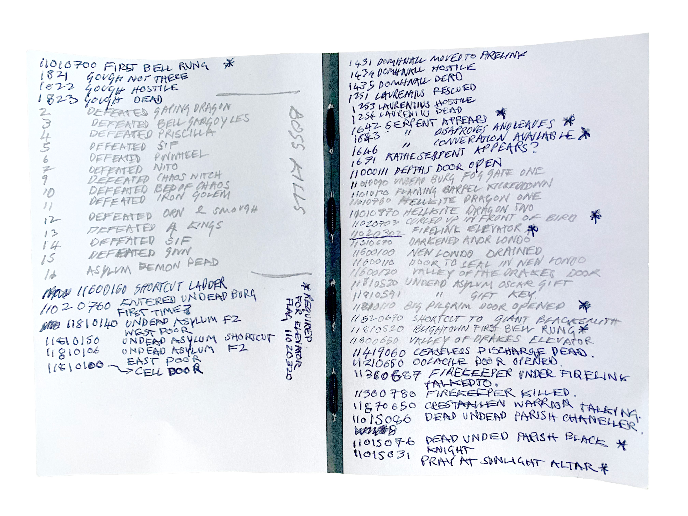
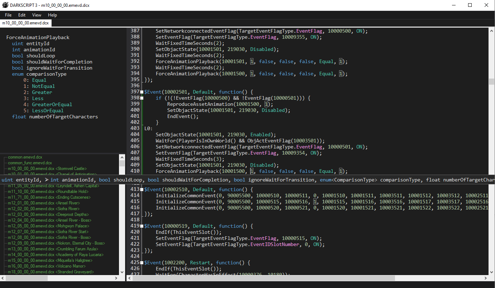
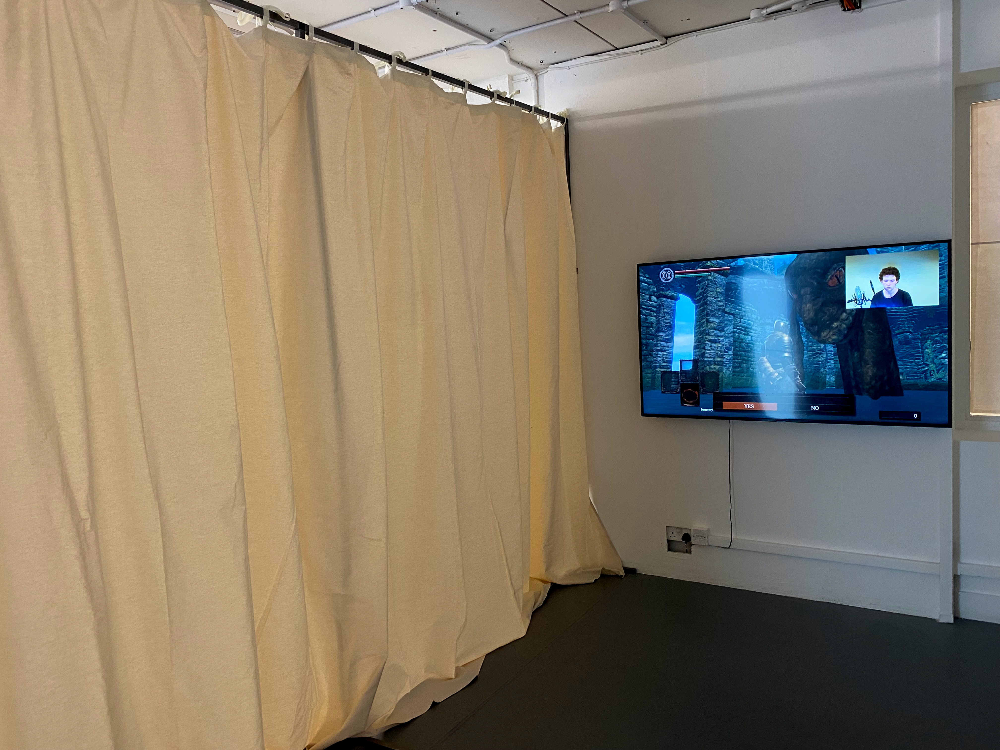
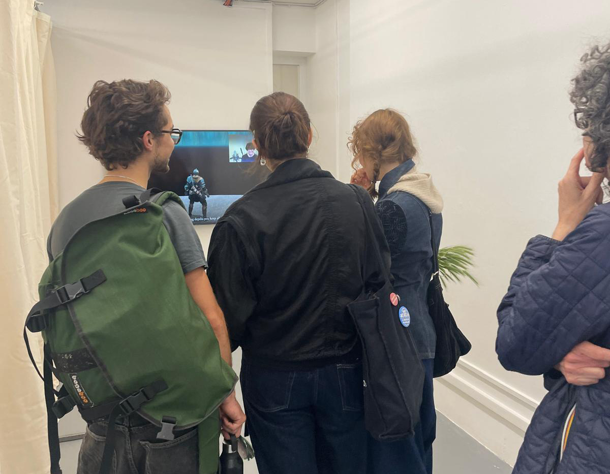
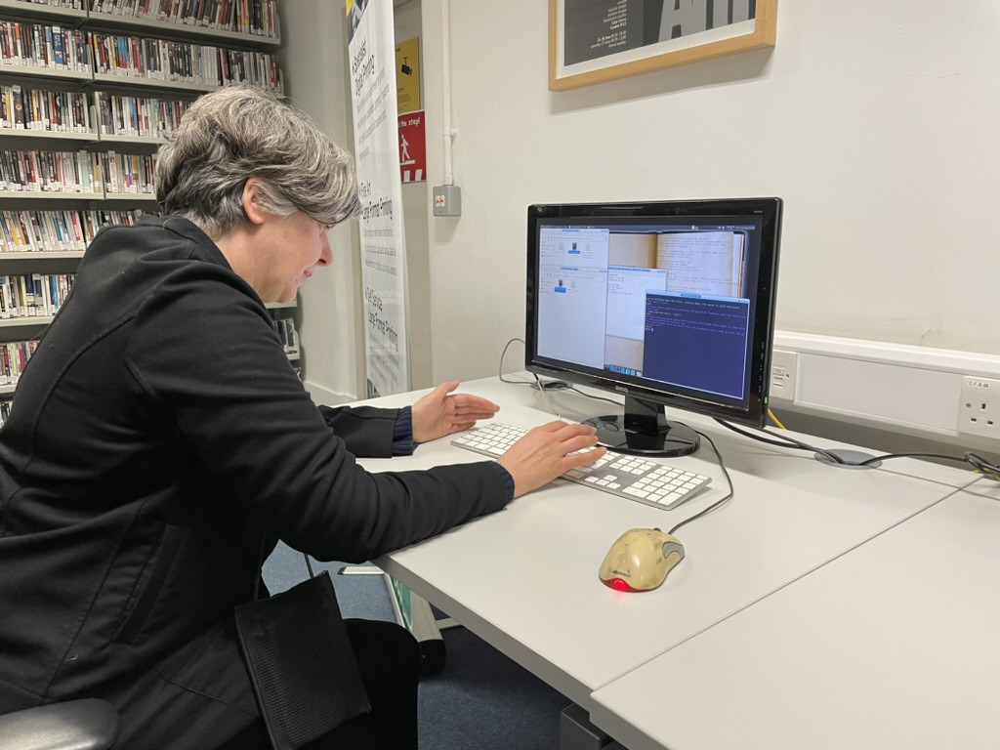
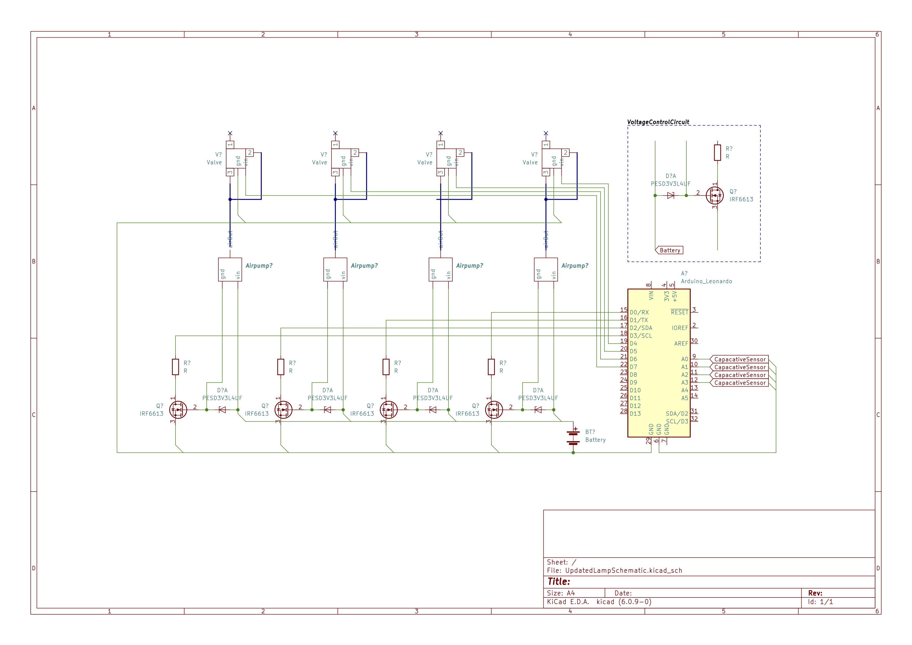

***Digital***

***Play for Phobia / Scapegoat***

<iframe width="100%" height="400" src="https://www.youtube.com/embed/pHVP8ojKhMY?si=-aPuw5004F8QGvFr" title="YouTube video player" frameborder="0" allow="accelerometer; autoplay; clipboard-write; encrypted-media; gyroscope; picture-in-picture; web-share" referrerpolicy="strict-origin-when-cross-origin" allowfullscreen></iframe>

‘Phobia/Scapegoat’ is a play I wrote and acted in the form of a “let’s play” video that documents the play through of a video game. The video shows a game that I ‘modded’ (modified) to change key aspects. In this way, I was able to ‘take part’ by replying to character dialogue that I had altered, and added new scenes to create an alternate narrative.

The film is an excerpt from a long livestream of me playing through the mod. It is a 25 minute journey to get through the script, and there were many times where I had to restart the narrative due to a mishap in the game. However, it was important to me that the film was recorded live. 

I wanted the film to have a strong sense of time passing and a feeling of the space within the world being a big one, with very real distances. I wanted the large periods of empty space (simply walking) to make the protagonist feel more part of the world, and thereby the words more important. I had the option to re-record the camera and the speaking, but chose not to for this reason. I chose to sit in the discomfort of those moments and ask the viewer to do the same.

I had often recycled assets from other games into my own, but had never fully modded a game. I was interested in how modding subverts a set of pre-existing expectations of the game, especially if it is already known to the viewer. By settling into and working with these assumptions, one can disorientate the viewer. Playing with tropes like the “let’s player” builds walls to break down or skin to peel off.

Modding this game was very difficult. It is developed by a Japanese company so the code comments are in Japanese, and it uses a custom engine. I chose this game because it is a game I care for, and means something to me. I feel it nurtures me in the same way that I nurture it. 

 

 

<embed src="/pdfs/script.pdf" width="100%" height="700" type="application/pdf">
*Script*
 
 

 
 

***Operating System for Alex***

Using Arch Linux (a Linux distribution which is close to a blank slate). 'Operating System for Alex' is an operating system on a Raspberry Pi which told a narrative. I filled the file system with text files and small console based games, creating a narrative, and built the operating system to direct the user into the narrative. I exhibited in the library at Chelsea, hijacking one of the computer monitors and putting my computer there instead. I liked hiding the piece in plain sight, a computer amongst other computers, and I liked to imagine confusion and intrigue upon finding the work.
 

 

***Robotics***

I have enjoyed working with hardware like Arduino to create machines. The video shows a soft robot that responds to touch by using pumps to inflate bags and move in certain directions. 

 
 

***Video Games***

Making art games was the main part of my practice from the years of 2019-21. They are a very variable medium, and working with them taught me to see unusual things as a mode of expression. I think they were an important influence on my later work and writing in the form of game modding, file systems, and wikipedia pages.

 

<i>

</i>

 