

***Intaglio***

I studied printmaking at the Royal Academy of Antwerp for half a year during my degree. Here, in a culture that valued the craft and rigour of traditional printmaking, I learnt about intaglio, lithography, woodcut and screenprinting. During my time there, I focused mainly on intaglio, specifically copperplate etching.

Antwerp is where I discovered my love for etching. Through the complex and delicate nature of the process, I found that small mistakes could lead to unexpected effects. This  encouraged me to experiment with the process and materials, such as intentionally burning the ground to create a speckled effect around the edge of ‘Man II’. In ‘Man I’ and in ‘Horses’, I also experimented with relief etching, which led to interesting effects and ways to apply ink.

 

<!-- 

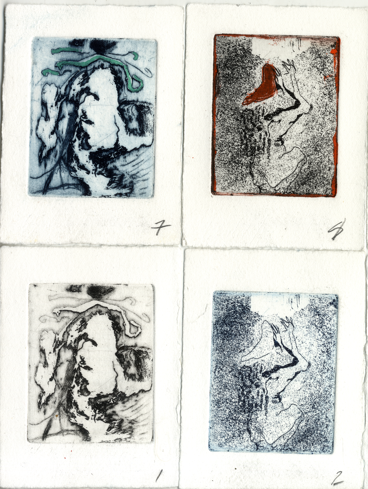
<i>
Small Prints One
</i>

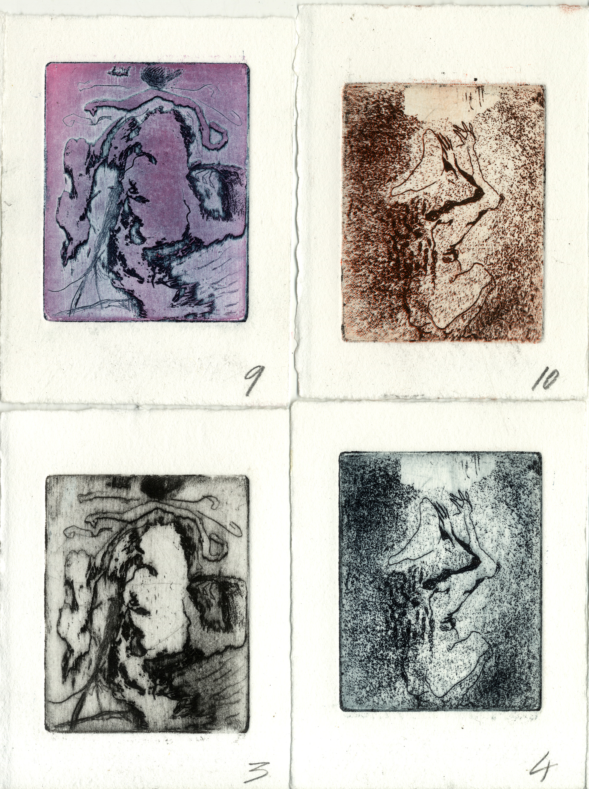
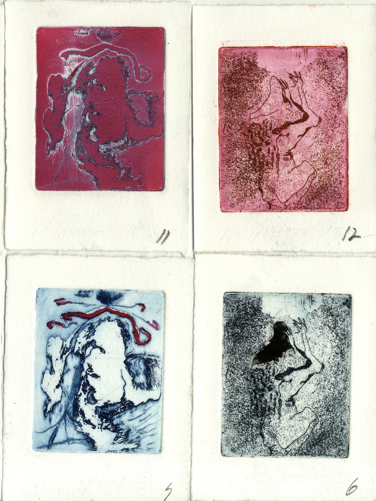

 -->

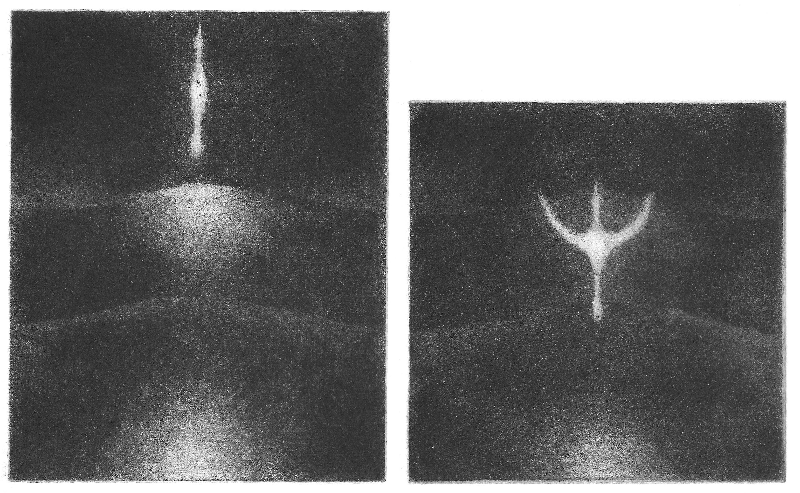

 

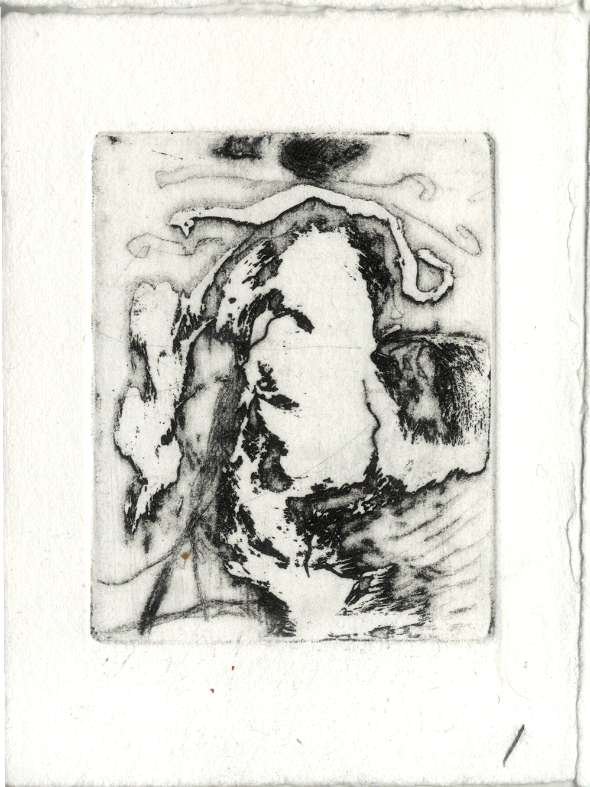

 

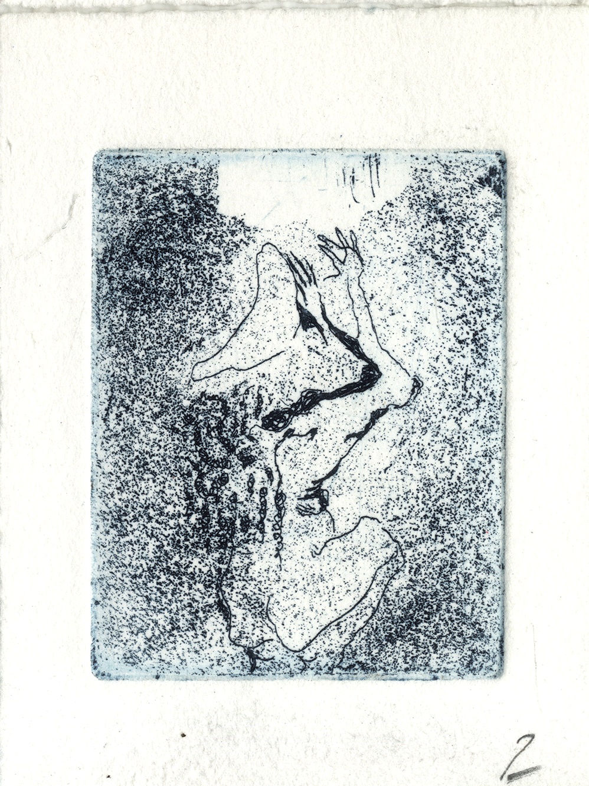

 

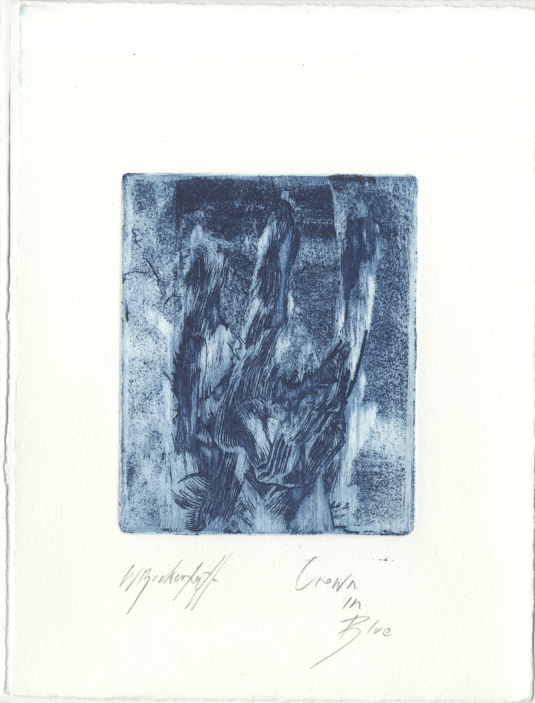

 

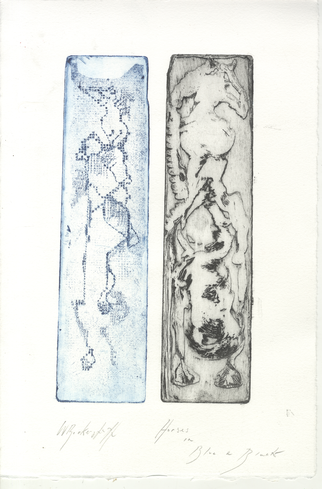

 

***Home prints***

When I had finished in Antwerp, I no longer had access to any printmaking facilities at Chelsea. In response, I bought ferric chloride online so I could etch my own plates. This has some challenges in terms of quality and consistency, but allows me to continue to work in the medium. More recently I have begun to work at St Barnabus Press in Cambridge. 

 

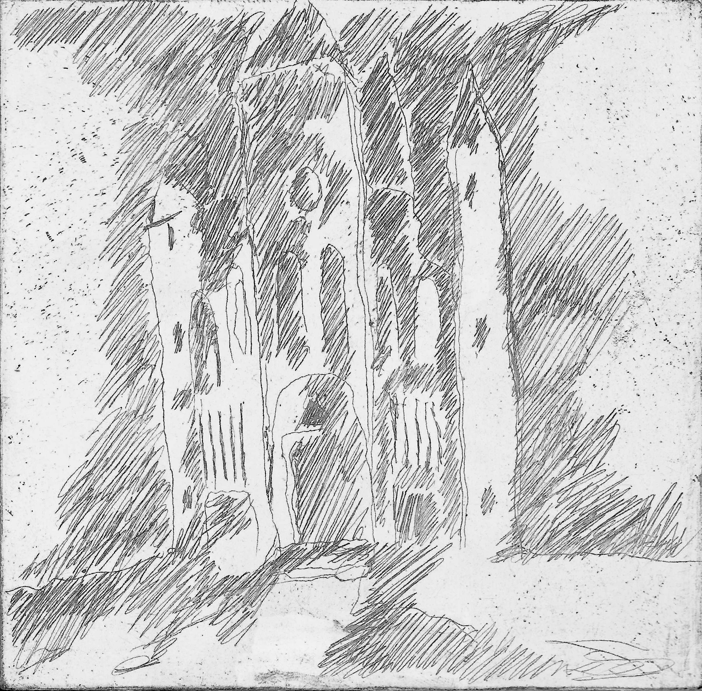

 

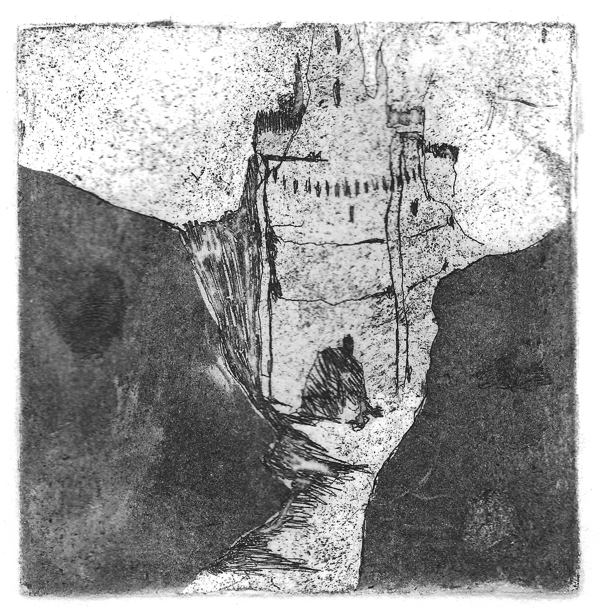

 

***Plan 76 – sleeves***

'Man I’ and ‘Man II’ were used as the covers for The Orchestra (For Now) second EP, ‘Plan 76’. Three different editions were released, with different colourways and limited edition original prints.

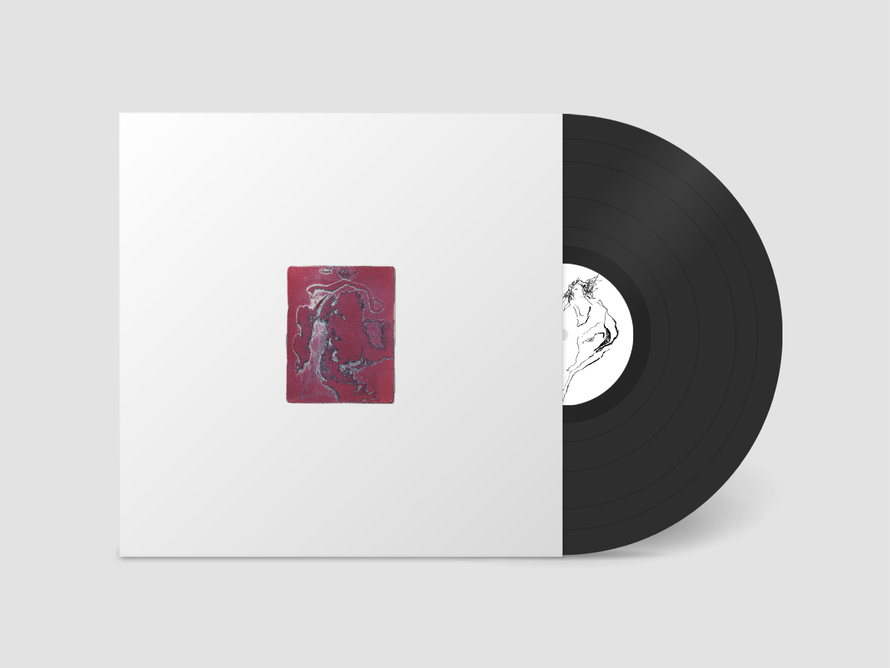
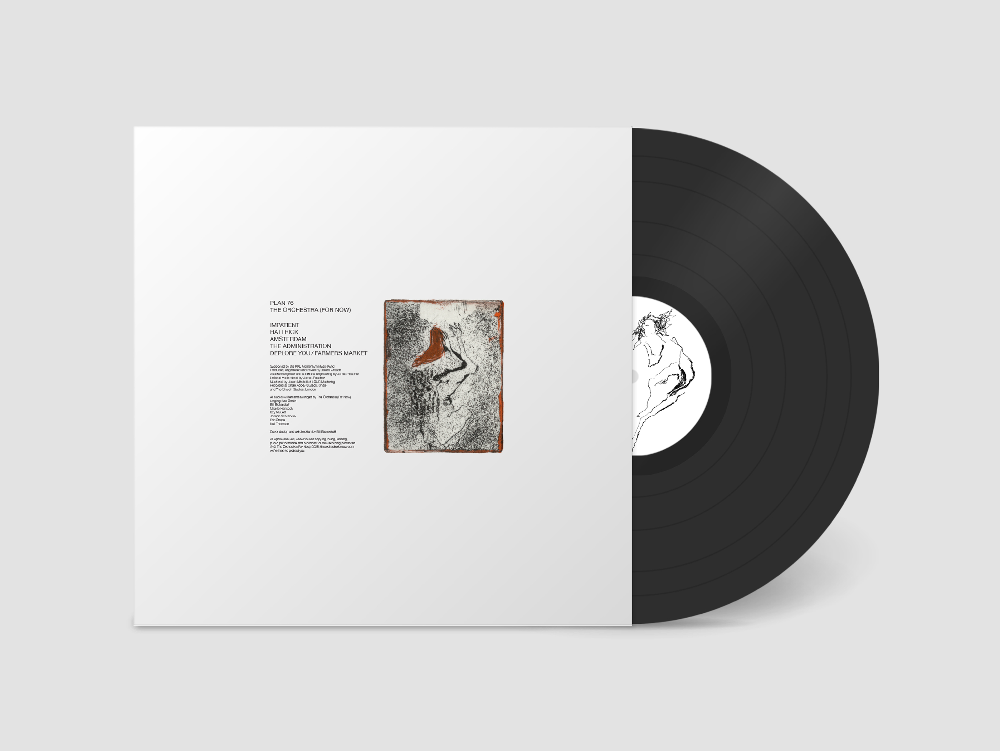
